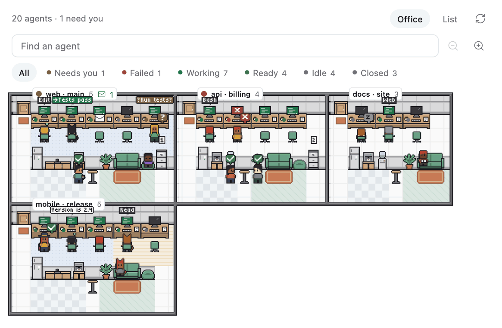
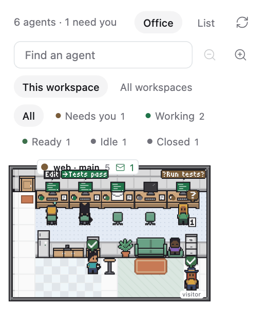
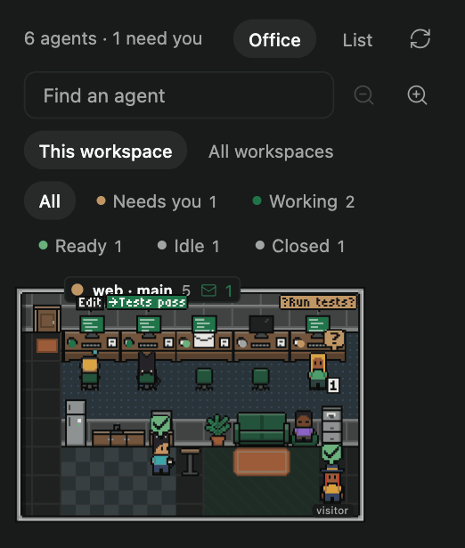
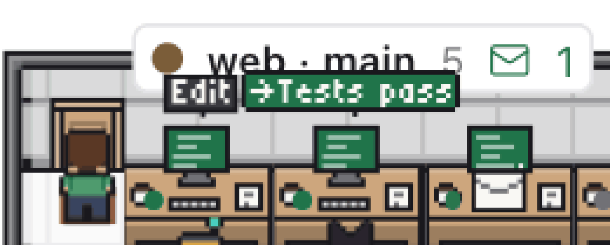

# Agent Lobby

A plugin that shows your agents as a small pixel-art office. Each workspace is a room, each
agent has a desk, and a character's pose tells you what its agent is doing: typing, waiting for
you, finished, resting, or gone home. It lives in a side pane and is meant to be glanced at.

<p>
  
</p>

Every picture here is drawn from an invented fleet: the workspaces, agents and messages in them do
not exist.

It adds two things to Paseo:

- **Lobby tab** in a workspace's Explorer (also openable as a workspace tab): the room of that
  workspace, with a switch to show every workspace. A header button and the Command Center item
  **Open Lobby** open it.
- **Lobby surface** (Command Center: **Open Lobby across workspaces**): every workspace at once as
  one floor plan, rooms of different sizes sharing walls, each with its own door. Workspaces whose
  agents are all closed stay folded away until a search or the Closed filter asks for them.

## Reading the office

| State | What you see |
| --- | --- |
| Working | seated and typing, code scrolling on the screen |
| Needs you | at the desk with a `?`, and the permission request in a bubble |
| Failed | at the desk, error screen, a cross |
| Ready | at the pantry with the others who have finished, a check bobbing over its head, its screen left on; after 15 minutes, standing at its desk |
| Idle | resting for 15 minutes (on the sofa, dozing, reading, at the shelves, stretching), then asleep at the desk |
| Closed | no desk: it walks out, and the room's filing cabinet counts it |

<p>
  
  
</p>

<p>
  
</p>

<p>
  
</p>

Dark versions: [surface](docs/lobby-surface-dark.png), [list](docs/lobby-list-dark.png),
[close-up](docs/lobby-closeup-dark.png).

- **Messages.** A message from one agent to another shows as a pixel bubble over the sender and an
  envelope that travels to the recipient's desk. A working agent's bubble names its tool in a word
  (`Bash`, `Read`, `Edit`, `Web`, ...) or shows the start of what it is saying, on up to three
  short lines. A screen reader gets the full line.
- **Walking.** When an agent starts work, finishes, takes a break or closes, its character walks
  there along the aisle and the room's corridor. A new agent walks in from the door.
- **Seats.** A seat comes from who started an agent and when, never from what it is doing, so
  nobody moves when somebody else starts or finishes. Closing is the one thing that frees a desk:
  the agent walks out, then the teammates seated after it walk one desk up.
- **Teams.** Agents started by the same agent sit together on a floor of their own. An agent whose
  starter lives in another workspace's room has that starter standing in its lounge as a visitor.
- **Closed agents.** Pressing a room's filing cabinet lists them, each with what can still be done.
- **Search and filters.** They dim everyone who does not match, in place, and mark the cabinet of a
  room with a closed agent that matches.
- **Detail.** Selecting a character shows its recent chat, read-only: up to its last 24 lines, with
  what you typed, what it wrote (appearing as it streams), one line for a run of tool calls, and a
  line pointing to the full chat for anything this view does not draw. Above it are pending
  permissions with Allow, Deny and Review, and icons for details (workspace, directory, labels,
  last error), Open, Message and Archive. Archive confirms first.
- **List.** The toggle beside Office shows the same agents as rows ordered by state then age, each
  with a small animated state icon and the same detail underneath.
- **Roles.** An optional `ghostline/role` label on an agent changes its character's outline:
  `overseer` wears a hat and cape, `nexus` a headset, `meow` cat ears and a tail. Without the
  label an agent is a plain character. Labels only change the drawing; the plugin grants nothing.
- **Reduced motion.** Nothing walks, travels or loops: characters stand where they belong, a line
  joins sender and recipient, and every animation shows its first frame.

## Size

The office is small on purpose. It is drawn at the crisp size nearest 1.2 screen pixels per art
pixel and never under 1: 1.2 on a 1.67x display, 1.0 on 1x and 2x displays, 1.33 on 3x. A
character is about 19 by 29 pixels on a 1.67x display, and a four-desk room with its pantry and
lounge fits a 313-pixel Explorer pane as a strip about 115 pixels tall. Bubbles and the cabinet's
count are drawn at the same scale, in a 3 by 5 pixel face.

A wider pane, such as the Lobby as a workspace tab or the Lobby surface, draws the office larger:
at the largest crisp size up to 2 at which the whole office still fits across. That is 2.0 on 1x,
2x and 3x displays and 1.8 on a 1.67x one; an office already as wide as the pane stays as above.

## What it costs

Measured in the Paseo desktop app on an Apple M4 (10 cores, 120 Hz display, 1.67x), against the
same view with its animations stopped. CPU is a share of one core; the measurements are noisy, so
read them as ranges.

| Situation | Cost |
| --- | --- |
| Pane hidden behind another tab, or app in the background | no timers, subscriptions or requests |
| List, 28 animated icons | not distinguishable from no animation (2 pairs) |
| Office, about 30 looping animations on screen | about 1 to 4 points of one core (5 pairs) |
| Daemon | no measurable difference with the plugin open or closed |

Frame animations are driven by one shared timer that wakes only when a visible frame is due and
does not run when nothing loops; walks, fades and envelopes are CSS transitions that end. A
running CSS animation was measured at 5 to 6 points of a core however few loops it drove, which is
why loops do not use one. Rooms scrolled out of view rest their animations.

## Data

One page-walk of `agents.list` when the pane is shown and one list subscription, whose
`agent_update` events are applied in place. The subscription replays nothing after the connection
drops, so when it is restored agents and workspaces are both loaded again; the same on Refresh and
whenever the pane is shown again. As a last resort agents are refetched every five minutes: that
is the longest a lost update can go unrepaired while the connection itself looks healthy.
Workspace names come from `workspaces.list` and refresh on `workspace_update`, and when an agent
turns up in a workspace not yet known.

Speech and messages come from agent timelines. Each timeline subscription costs the daemon one, so
the plugin keeps at most eight open per daemon connection, however many Lobby tabs and surfaces
are mounted: views share one registry, and two views watching the same agent share one
subscription. Each view asks for the working and waiting agents of the rooms it has on screen;
when the eight are taken, a view goes without and asks again half a minute later. Everyone else is
drawn from `agent_update` alone. The chat of the selected agent draws on the same eight: it shares
a subscription the bubbles already hold, takes one only while the agent is working or waiting on
you, and gives it back when you look elsewhere, when the agent stops or when the pane is hidden. An
idle agent's chat is one request for its last 60 timeline entries, about 40 to 120 KB for a busy
agent, most of it tool output. A message typed by a person is never read as a message between
agents: only the daemon's own record of an agent-to-agent message, with its verified sender, is.

## Art

Every sprite, tile and the two pixel fonts are original and drawn in `client/pixel/` as code: text
grids, a palette taken from the Paseo theme, and a small PNG encoder. No third-party asset is
bundled.

## Install

```bash
git clone https://github.com/linhmh8/agent-lobby
cd agent-lobby
paseo plugin install "$PWD"
```

Requires Paseo 0.11.2 or newer: that is the first release whose daemon hands clients a message
between agents with its verified sender. There is no build step and nothing to configure.
Paseo supplies the runtime modules; npm dependencies are only needed for development.

## Develop

Use Node.js 24 or newer and install development dependencies before checking changes:

```bash
npm ci
npm run check                # tsc + vitest
paseo plugin reload lobby    # recompile and reload in the running app
```

- `client/model.ts`: agent state, the forest of who started whom, filters. Pure, tested.
- `client/office-model.ts`: rooms, desks, seats, zones, breaks, where each character is. Pure, tested.
- `client/exchanges.ts`, `client/feed-plan.ts`, `client/feed-hub.ts`: messages and bubbles, which
  timelines to subscribe to, and the shared budget. Pure, tested.
- `client/chat-model.ts`: the selected agent's chat, folded from a page and its live events, and
  when it subscribes. Pure, tested. `client/use-chat.ts` and `client/chat.tsx` bind and draw it.
- `client/scene-model.ts`, `client/motion-model.ts`, `client/wake.ts`: scale, walk paths, frame
  timing, when a hidden pane lets go. Pure, tested.
- `client/pixel/`: the art, the fonts and the encoder. Pure, tested.
- `client/office.tsx` is the scene and draws only through `client/sprites.tsx`;
  `client/crew-view.tsx` hosts the office, the list, the detail and the dialogs;
  `client/web.ts` is the only file that touches a browser node.

## Known limits

- Verified in the Paseo desktop app (web renderer) only. The iOS and Android code paths are
  written and typechecked but have not been run on a device.
- At most four characters walk out at once: when more close together, as when a whole team is
  archived, the rest simply go.
- Bubbles drop Vietnamese tone marks and other accents (`Lỗi` reads `Loi`), and at this size their
  text is something to lean in for, not to read across the room.

## Acknowledgements

- [agent-town](https://github.com/geezerrrr/agent-town) for the idea of agents as workers in a
  pixel office, with seats, wandering and speech bubbles as the language of state. None of its
  code, art, tiles or map is used here.
- [Gather](https://www.gather.town) for the picture of a shared office seen from above.
- [Bàn về multi-agent orchestration và mô hình SLP](https://vhlam.com/article/agent-orchestration-multi-agent-slp),
  the article that inspired this project: it is what made orchestrating agents a daily practice,
  and it opened up what working with agents can be. With gratitude to its author.
- [Paseo](https://paseo.sh) ([source](https://github.com/getpaseo/paseo)) and its plugin SDK, which
  this runs on and whose plugin documentation it follows.
- [React Native](https://reactnative.dev) and
  [React Native for Web](https://necolas.github.io/react-native-web/), the primitives everything
  here is drawn with.

Licensed under MIT, as declared in `package.json`.
